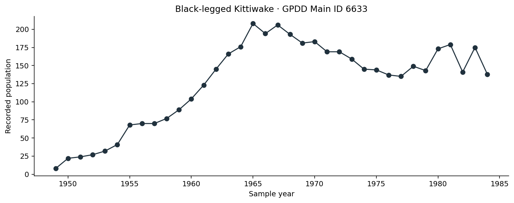
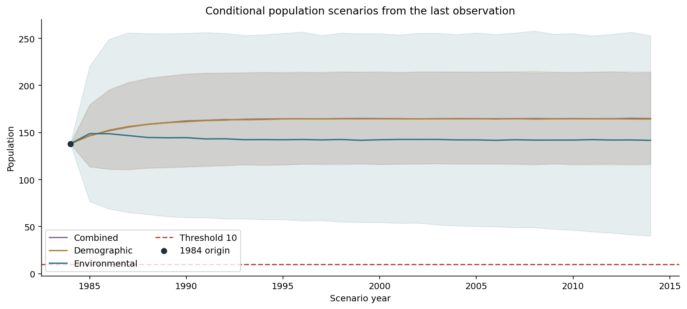
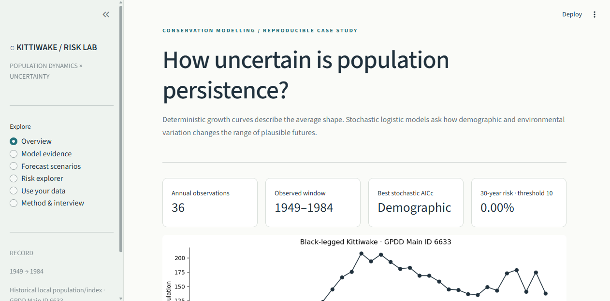
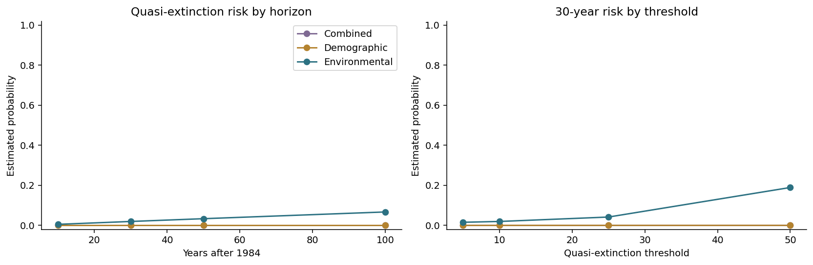

# Kittiwake Population Risk Lab

**How does stochastic variation change the future of a historical seabird population?**

A reproducible reconstruction of *Modelling Extinction Risk in Black-Legged Kittiwake: A Statistical Exploration using Python*, with corrected quasi-extinction logic, small-sample model comparison, chronological validation, scenario sensitivity and an interactive upload-driven dashboard.



## Start here

- [Generated empirical results](artifacts/RESULTS.md)
- [Executed analysis notebook](notebooks/01_kittiwake_population_risk.ipynb)
- [Methodology and interpretation contract](docs/METHODOLOGY.md)
- [Source-project audit and corrections](docs/PROJECT_AUDIT.md)
- [Interview walkthrough](docs/INTERVIEW_GUIDE.md)
- [Dataset card](docs/DATA_CARD.md)

## Run the dashboard

Python 3.11+ is supported. From the repository root:

```bash
python -m venv .venv
```

Activate with `.venv\Scripts\Activate.ps1` on Windows or `source .venv/bin/activate` on macOS/Linux, then:

```bash
python -m pip install -r requirements.txt
python -m streamlit run app.py
```

Committed artifacts let the dashboard open without refitting. To reproduce the full analysis:

```bash
python -m population_risk
```

## What this project implements

| Analysis | Implementation |
| --- | --- |
| Deterministic population growth | Exponential, logistic and Gompertz nonlinear fits |
| Small-sample model comparison | AIC, AICc, BIC and Akaike weights |
| Stochastic logistic dynamics | Demographic, environmental and combined transition variance |
| Parameter estimation | Bounded multi-start maximum likelihood |
| Forecast assessment | Chronological 75:25 holdout against persistence |
| Future uncertainty | Seeded forward simulation and conditional 95% path quantiles |
| Quasi-extinction | First-passage simulations with absorbing threshold |
| Monte Carlo uncertainty | Wilson binomial intervals, including zero-event runs |
| Structural sensitivity | Three candidate models plus AICc-weighted probability |
| Scenario sensitivity | Thresholds 5/10/25/50 and horizons 10/30/50/100 |
| Generalizable interface | Validated CSV/XLSX upload and model fitting |



## The central correction

The source notebook defaults to the first observed population, `8`, while defining quasi-extinction as population `≤10`. Because it checks only after advancing the process, it does not acknowledge that the starting state is already below the threshold. It also uses inconsistent 30-, 50- and 100–1,000-year horizons.

This project defines the primary scenario as:

- origin: final recorded observation, population 138 in 1984;
- horizon: 30 years;
- quasi-extinction: first simulated population `≤10`;
- convention: threshold crossing is absorbing;
- uncertainty: 20,000 seeded paths per model and Wilson Monte Carlo intervals.

The generated results replace the report's 53.1% claim. They must be read as conditional historical scenarios, not a current forecast for the global species.

## Dashboard



The dashboard exposes model evidence, path uncertainty, threshold/horizon sensitivity, exact run metadata and a session-only uploader for another population series.

## Evidence before scenarios

All three deterministic and stochastic candidates are fit to the full record for descriptive comparison. A separate chronological experiment fits the first 27 observations and tests the remaining nine. Persistence repeats the previous observation and anchors the forecast comparison.

AICc weights summarize relative support inside the candidate set. A mathematical “demographic noise” winner does not prove demographic causation: sampling error, omitted covariates and model misspecification remain plausible.

Selected full-run results:

| Evidence | Result |
| --- | ---: |
| Deterministic AICc winner | Logistic (weight 94.37%) |
| Stochastic AICc winner | Demographic (weight 78.24%) |
| Best holdout MAE | Environmental, 18.20 |
| Persistence holdout MAE | 19.33 |
| Demographic 30-year events at threshold 10 | 0 / 20,000 |
| Demographic Monte Carlo 95% upper bound | 0.0192% |

The stochastic candidates only slightly improve holdout MAE over persistence, and the test contains nine values. The result supports caution, not a claim of dependable forecasting superiority.



## Data and scientific boundaries

The supplied workbook has 36 annual observations from 1949 to 1984 and is attributed by the source report to GPDD Main ID 6633. Sampling location, measurement unit, original source URL and data license are not present. The record should be treated as a local population/count index, not global species abundance.

The model omits observation error, age structure, migration, management actions, spatial processes and environmental covariates. Gaussian Euler transitions can be negative; simulations truncate at zero. Forecast bands condition on fitted parameters and therefore understate total uncertainty. See the [methodology](docs/METHODOLOGY.md) before interpreting any probability.

## Repository structure

```text
population_risk/    Validated data, models, simulation, evaluation and reporting
data/               Original supplied GPDD-identified workbook
artifacts/          Generated tables, figures, settings and results report
app.py              Streamlit research dashboard and upload interface
docs/               Methodology, source audit, data card and interview guide
tests/              Data, model, simulation, artifact and dashboard tests
notebooks/          Executed result walkthrough
scripts/            Notebook builder
.github/workflows/  Automated verification and manual full reproduction
```

## Verify

```bash
python -m pip install -r requirements-dev.txt
python -m ruff check population_risk app.py tests
python -m pytest -q
python scripts/build_notebook.py
```

## Attribution

The supplied final report credits **Riddhimann Chattopadhyay**, Department of Statistics, Ramakrishna Mission Residential College (Autonomous), Narendrapur. This repository reconstructs and extends that study. The original report and exploratory notebooks remain outside GitHub because they include student identifiers and hard-coded local paths.

The source dataset's redistribution license was not included. No new ownership claim or data license is inferred.
