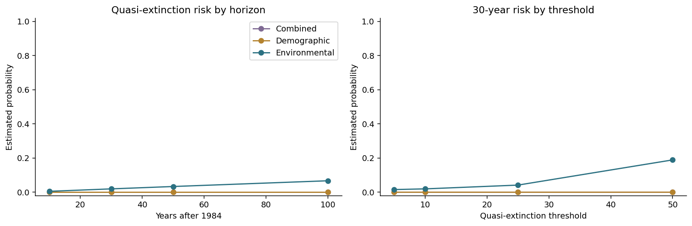

# Generated results

Data SHA-256: `bd135f90e1bc9bd848ab40e9484668062febe6875b89c668dccba989d738e631`. 36 annual observations,
1949–1984. Simulations start at the final observed
population, **138**, and seed 42.

## Deterministic growth curves

| model | aicc | bic | rmse | akaike_weight |
| --- | --- | --- | --- | --- |
| Logistic | 328.9429 | 333.9866 | 20.5052 | 0.9437 |
| Gompertz | 334.5814 | 339.6252 | 22.1756 | 0.0563 |
| Exponential | 381.0131 | 385.0136 | 43.7793 | 0.0000 |

AICc is primary because only 36 observations are available. These scores compare in-sample
Gaussian residual models; they do not establish biological truth.

## Stochastic logistic models

| model | growth_rate | carrying_capacity | sigma_demographic | sigma_environmental | aicc | akaike_weight |
| --- | --- | --- | --- | --- | --- | --- |
| Demographic | 0.3397 | 168.5814 | 1.4325 | — | 293.4725 | 0.7824 |
| Environmental | 0.5044 | 163.5253 | — | 0.2642 | 337.3463 | 0.0000 |
| Combined | 0.3397 | 168.5816 | 1.4325 | 0.0000 | 296.0316 | 0.2176 |

The transition likelihood uses each observed year gap and the report's Euler–Gaussian
approximation. The combined model can reduce to a boundary case, so asymptotic parameter
uncertainty and information-criterion interpretations require caution.

## Chronological holdout

| model | mae | rmse | mean_log_score |
| --- | --- | --- | --- |
| Environmental | 18.2015 | 20.7946 | 4.8254 |
| Combined | 19.0256 | 22.5084 | 4.6029 |
| Demographic | 19.0256 | 22.5084 | 4.6029 |
| Persistence | 19.3333 | 24.0139 | — |
| Logistic | 27.4476 | 32.2953 | — |
| Gompertz | 29.9186 | 34.3405 | — |
| Exponential | 118.7567 | 123.1098 | — |

Models are fitted on the first 27 observations and evaluated on the
remaining 9. Persistence predicts the previous observed population.
The deterministic curves forecast calendar year; stochastic models make one-step conditional
predictions using the previous observed value. `mean_log_score` is available only for stochastic models.

## Quasi-extinction scenario

| model | horizon | threshold | events | simulations | probability | mc_ci_low | mc_ci_high |
| --- | --- | --- | --- | --- | --- | --- | --- |
| Demographic | 30.0000 | 10.0000 | 0.0000 | 20000.0000 | 0.0000 | 0.0000 | 0.0002 |
| Environmental | 30.0000 | 10.0000 | 391.0000 | 20000.0000 | 0.0196 | 0.0177 | 0.0216 |
| Combined | 30.0000 | 10.0000 | 0.0000 | 20000.0000 | 0.0000 | 0.0000 | 0.0002 |
| AICc-weighted | 30.0000 | 10.0000 | — | 20000.0000 | 0.0000 | — | — |

This is a **conditional model scenario**, not a forecast of the global species or an IUCN
assessment. Quasi-extinction means the simulated local index first reaches or falls below 10.
The start is the last recorded value (1984), not the first value of 8 that is already below the
report's threshold. A zero-event result means the risk was below the resolution of this Monte
Carlo run; the Wilson upper bound remains positive.

## Interpretation limits

- The record contains one local population/index with 36 annual observations and ends in 1984.
- Observation error, sampling protocol, interventions, dispersal, age structure and covariates are absent.
- Gaussian Euler transitions can produce negative proposals; simulations truncate at zero and make
  quasi-extinction absorbing. This numerical convention materially affects tail risk.
- Prediction bands and extinction probabilities condition on fitted parameters. They omit full
  parameter and structural uncertainty, so they are narrower than a complete predictive analysis.
- AIC/AICc ranks candidates in this set. It cannot prove that demographic variability is literally
  the ecological mechanism, especially when the combined fit reaches a boundary.
- Threshold and horizon choices are scenarios. See `risk_sensitivity.csv` before quoting one number.
- The original report's 53.1% result is not reproduced because its code starts at population 8 while
  defining values at or below 10 as quasi-extinct, and notebook horizons do not consistently match the report.
